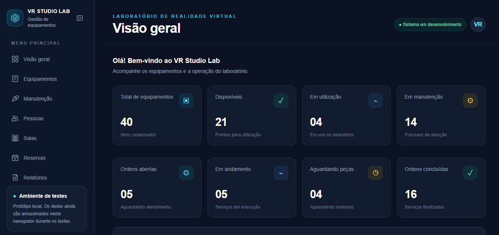

 
<div align="center">

# VR STUDIO LAB

### Sistema de gerenciamento de Laboratório de Realidade Virtual e Audiovisual

**Tecnologia, organização e inovação para o laboratório.**

[](https://juliogeraldoeng.github.io/vrstudiolab/)


</div>

---

## Apresentação

O **VR Studio Lab** é uma aplicação web desenvolvida para auxiliar no gerenciamento e na organização de um Laboratório de Realidade Virtual e Audiovisual.

A plataforma reúne ferramentas para controle de equipamentos, acompanhamento de manutenções, gerenciamento de pessoas, organização de salas, reservas e emissão de relatórios.

O objetivo é centralizar as informações do laboratório em um único ambiente, facilitando o acompanhamento dos recursos, a organização das atividades e a administração dos equipamentos.

## Demonstração

<div align="center">



*Painel principal do VR Studio Lab.*

</div>

**Acesse a versão publicada:**

https://juliogeraldoeng.github.io/vrstudiolab/

## Funcionalidades

| Módulo | Descrição |
|---|---|
| **Dashboard** | Visão geral do laboratório e indicadores de equipamentos e manutenções. |
| **Equipamentos** | Cadastro, consulta e acompanhamento do inventário. |
| **Manutenção** | Gerenciamento de ordens de serviço e acompanhamento dos status de manutenção. |
| **Pessoas** | Cadastro e gerenciamento das pessoas relacionadas ao laboratório. |
| **Salas** | Cadastro e organização dos ambientes disponíveis. |
| **Reservas** | Gerenciamento de reservas de salas e equipamentos. |
| **Calendário** | Visualização de reservas e períodos de manutenção. |
| **Relatórios** | Consulta e exportação de informações do laboratório. |
| **Backup e importação** | Exportação e recuperação de dados do ambiente de testes. |

## Tecnologias utilizadas

O projeto utiliza as seguintes tecnologias e bibliotecas:

| Tecnologia | Finalidade |
|---|---|
| [Next.js](https://nextjs.org/) | Framework para desenvolvimento da aplicação web. |
| [React](https://react.dev/) | Construção das interfaces e componentes. |
| [TypeScript](https://www.typescriptlang.org/) | Tipagem estática e organização do código. |
| [Tailwind CSS](https://tailwindcss.com/) | Estilização da interface. |
| [jsPDF](https://github.com/parallax/jsPDF) | Geração de documentos PDF. |
| [jsPDF-AutoTable](https://github.com/simonbengtsson/jsPDF-AutoTable) | Criação de tabelas nos relatórios PDF. |
| [ESLint](https://eslint.org/) | Análise e padronização do código. |

## Como instalar e executar o projeto

### 1. Pré-requisitos

Antes de começar, é necessário instalar:

- **Node.js:** versão 22 recomendada.
- **Git:** para clonar e gerenciar o repositório.
- **Visual Studio Code:** editor recomendado para desenvolvimento.

Links para instalação:

- [Download do Node.js](https://nodejs.org/)
- [Download do Git](https://git-scm.com/)
- [Download do Visual Studio Code](https://code.visualstudio.com/)

Para verificar se o Node.js e o Git estão instalados, abra o PowerShell e execute:

```powershell
node -v
npm.cmd -v
git --version
```

### 2. Clonar o repositório

Abra o PowerShell ou o terminal do Visual Studio Code e execute:

```powershell
git clone https://github.com/JulioGeraldoEng/vrstudiolab.git
```

Entre na pasta do projeto:

```powershell
cd vrstudiolab
```

### 3. Instalar as dependências

Execute o comando:

```powershell
npm.cmd install
```

Esse comando instala todas as dependências necessárias, conforme definidas no arquivo `package.json`.

### 4. Executar em ambiente de desenvolvimento

Para iniciar o servidor local, execute:

```powershell
npm.cmd run dev
```

Após iniciar, abra o navegador no endereço:

http://localhost:3000

O ambiente de desenvolvimento permite visualizar e testar as alterações realizadas no código.

### 5. Gerar a versão de produção

Para verificar e gerar a versão de produção, execute:

```powershell
npm.cmd run build
```

O Next.js realiza a compilação e gera os arquivos da aplicação na pasta `out/`, conforme a configuração de exportação estática do projeto.

### 6. Verificar o código

Para executar a análise estática com ESLint:

```powershell
npm.cmd run lint
```

## Scripts disponíveis

Os principais comandos definidos no `package.json` são:

| Comando | Descrição |
|---|---|
| `npm.cmd run dev` | Inicia o ambiente de desenvolvimento. |
| `npm.cmd run build` | Gera a versão de produção. |
| `npm.cmd run start` | Inicia o servidor Next.js em modo servidor. |
| `npm.cmd run lint` | Executa a análise estática do código. |

> **Observação:** o projeto utiliza exportação estática para publicação no GitHub Pages. Por isso, o comando `start` não é necessário para executar a versão publicada.

## Estrutura do projeto

A organização principal dos arquivos está dividida da seguinte forma:

```text
vrstudiolab/
│
├── .github/
│   └── workflows/             # Automação e publicação no GitHub
│
├── app/
│   ├── components/            # Componentes reutilizáveis
│   │
│   ├── dashboard/             # Dashboard
│   ├── equipment/             # Equipamentos
│   ├── maintenance/            # Manutenção
│   ├── people/                # Pessoas
│   ├── reports/               # Relatórios
│   ├── reservations/           # Reservas
│   ├── rooms/                  # Salas
│   ├── seed/                   # Dados de demonstração
│   │
│   ├── globals.css             # Estilos globais
│   ├── layout.tsx              # Layout principal
│   └── page.tsx                # Página inicial
│
├── public/
│   └── images/
│       └── dashboard.png      # Imagem de apresentação
│
├── types/                     # Tipos compartilhados
│
├── .gitignore
├── AGENTS.md
├── next.config.ts             # Configuração do Next.js
├── package.json               # Dependências e scripts
├── package-lock.json          # Controle das versões
└── tsconfig.json              # Configuração do TypeScript
```

## Dados e ambiente de testes

Atualmente, o sistema utiliza o armazenamento local do navegador (`localStorage`) para persistir os dados do ambiente de testes.

Isso significa que os dados ficam armazenados no navegador utilizado e não são compartilhados automaticamente entre diferentes computadores ou usuários.

O projeto também disponibiliza dados fictícios para demonstração e testes das funcionalidades.

**Importante:** a versão atual é um protótipo em desenvolvimento. A integração com banco de dados e autenticação compartilhada está prevista para etapas futuras.

## Publicação

O projeto está publicado por meio do **GitHub Pages**.

A publicação utiliza os recursos de exportação estática do Next.js, com os arquivos gerados na pasta `out/`.

**Endereço de acesso:**

[https://juliogeraldoeng.github.io/vrstudiolab/](https://juliogeraldoeng.github.io/vrstudiolab/)

O repositório do projeto está disponível em:

[https://github.com/JulioGeraldoEng/vrstudiolab](https://github.com/JulioGeraldoEng/vrstudiolab)

## Próximas etapas

O VR Studio Lab continua em desenvolvimento. Entre as melhorias planejadas estão:

- Integração com banco de dados.
- Autenticação por e-mail institucional.
- Controle de acesso por perfis de usuário.
- Compartilhamento de informações entre computadores.
- Aprimoramento dos módulos de reservas e manutenção.
- Novos indicadores e funcionalidades de gerenciamento.

## Autor

**Julio Geraldo**

Projeto desenvolvido para gerenciamento de Laboratório de Realidade Virtual e Audiovisual.

---

<div align="center">

**VR STUDIO LAB**

*Organização, tecnologia e inovação para o laboratório.*

</div>
