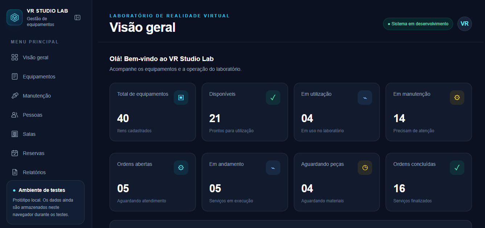

# VR STUDIO LAB

### Sistema de gerenciamento de Laboratório de Realidade Virtual e Audiovisual

**Tecnologia, organização e inovação para o laboratório.**

[](https://juliogeraldoeng.github.io/vrstudiolab/)


---

## 1. Apresentação do projeto

O **VR Studio Lab** é uma aplicação web desenvolvida para auxiliar na organização, no gerenciamento e no acompanhamento das atividades de um Laboratório de Realidade Virtual e Audiovisual.

O sistema reúne, em um único ambiente, funcionalidades para controle de equipamentos, gerenciamento de pessoas, acompanhamento de manutenções, organização de salas, reservas de recursos e emissão de relatórios.

A proposta é facilitar a administração do laboratório, centralizando informações que normalmente ficam distribuídas em planilhas, documentos ou controles manuais.

O projeto está sendo desenvolvido de forma modular, permitindo que novos recursos sejam incorporados gradualmente, sem a necessidade de reconstruir os módulos já existentes.

### Objetivos principais

- Organizar o inventário de equipamentos e recursos do laboratório.
- Registrar e acompanhar ordens de serviço e solicitações de manutenção.
- Manter o cadastro das pessoas relacionadas ao laboratório.
- Organizar salas e ambientes disponíveis.
- Controlar reservas de salas e equipamentos.
- Disponibilizar um calendário para acompanhamento das atividades.
- Gerar relatórios para consulta e acompanhamento operacional.
- Estabelecer diferentes níveis de acesso conforme as responsabilidades dos usuários.
- Preparar a aplicação para futura utilização compartilhada por diferentes computadores e usuários.

## 2. Demonstração e acesso

<div align="center">



*Painel principal do VR Studio Lab.*

</div>

**Sistema publicado:**

https://juliogeraldoeng.github.io/vrstudiolab/

**Repositório do código-fonte:**

https://github.com/JulioGeraldoEng/vrstudiolab

A aplicação está em desenvolvimento. Algumas funcionalidades já estão implementadas, enquanto outras fazem parte das próximas etapas do projeto.

## 3. Funcionalidades do sistema

### 3.1. Dashboard

O Dashboard é a página inicial da aplicação e funciona como ponto de acesso aos principais módulos.

Sua finalidade é oferecer uma visão geral do ambiente e facilitar a navegação entre as funcionalidades do sistema.

Entre os elementos previstos e implementados estão:

- Apresentação e identificação do sistema.
- Acesso aos módulos disponíveis.
- Resumos de informações do laboratório.
- Indicadores relacionados aos equipamentos.
- Resumo de atividades e informações do calendário.

### 3.2. Equipamentos

O módulo de Equipamentos permite cadastrar e acompanhar os recursos utilizados no laboratório.

Cada equipamento pode possuir informações como:

- Nome e identificação.
- Categoria.
- Número de patrimônio.
- Número de série.
- Localização.
- Sistema operacional, quando aplicável.
- Situação atual.
- Observações.

Os estados de conservação e utilização permitem acompanhar equipamentos disponíveis, em uso, em manutenção ou baixados.

O módulo também oferece recursos de consulta, cadastro, edição e gerenciamento dos registros, conforme as permissões do usuário.

### 3.3. Manutenção

O módulo de Manutenção permite acompanhar os problemas identificados nos equipamentos e registrar as respectivas ordens de serviço.

O sistema trabalha com diferentes etapas de acompanhamento:

- Aberta.
- Em andamento.
- Aguardando peças.
- Concluída.

As ordens de serviço permitem relacionar a manutenção a um equipamento e registrar informações sobre o atendimento.

Também existem funcionalidades para solicitações de manutenção, permitindo organizar os problemas comunicados pelos usuários e seu acompanhamento.

A conclusão de uma ordem de serviço possui informações relacionadas à execução e à autorização do atendimento.

### 3.4. Pessoas

O módulo de Pessoas permite cadastrar e administrar as pessoas relacionadas às atividades do laboratório.

Os registros podem conter informações como nome, categoria, contato, telefone, e-mail e situação do cadastro.

As categorias representam a relação da pessoa com o laboratório, por exemplo:

- Aluno.
- Técnico.
- Responsável autorizado.
- Professor.
- Gestor.
- Colaborador.

**Importante:** a categoria da pessoa não é a mesma coisa que seu perfil de acesso. Uma pessoa pode ser cadastrada como professor, por exemplo, e possuir um perfil de acesso específico no sistema.

### 3.5. Salas

O módulo de Salas permite cadastrar e organizar os ambientes utilizados pelo laboratório.

É possível manter informações sobre os espaços e acompanhar sua situação, facilitando a organização dos ambientes disponíveis para utilização e reserva.

As salas são tratadas separadamente dos equipamentos, pois representam recursos físicos distintos.

### 3.6. Reservas

O módulo de Reservas permite organizar solicitações e registros de utilização de salas e equipamentos.

O objetivo é evitar conflitos de horários e permitir o acompanhamento da disponibilidade dos recursos.

Entre os recursos contemplados estão:

- Cadastro de reservas.
- Seleção do recurso desejado.
- Definição de data e horário.
- Identificação do solicitante.
- Consulta das reservas.
- Acompanhamento de situações e cancelamentos.
- Registro de retirada e devolução de equipamentos reservados.
- Verificação de conflitos de horários.

As regras de utilização incluem limites de duração e antecedência, além de condições específicas de funcionamento dos ambientes.

### 3.7. Calendário

O calendário permite visualizar informações relacionadas às atividades do laboratório.

Ele reúne informações de reservas e manutenções, facilitando a consulta de datas e períodos importantes.

A intenção é permitir que o responsável pelo laboratório acompanhe a ocupação dos recursos e os compromissos operacionais em uma visão organizada por datas.

### 3.8. Relatórios

O módulo de Relatórios reúne recursos para consulta e exportação de informações do sistema.

O projeto utiliza bibliotecas para gerar documentos PDF e tabelas formatadas.

Entre os recursos existentes estão:

- Exportação de relatórios em PDF.
- Exportação de informações em CSV.
- Geração de backup dos dados contemplados pela funcionalidade.

A disponibilidade dos dados em cada relatório depende do módulo e dos recursos de exportação implementados.

### 3.9. Backup e importação

O sistema possui funcionalidades para exportar e importar arquivos de backup no formato JSON.

Na versão atual, o backup contempla especificamente:

- Equipamentos.
- Ordens de manutenção.
- Pessoas.

**Limitação importante:** o backup atual não inclui solicitações de manutenção, salas, reservas nem as configurações de permissões por perfil e por pessoa.

A importação substitui os dados dos três conjuntos contemplados no navegador utilizado. Portanto, deve ser realizada com atenção.

## 4. Controle de acesso e permissões

O VR Studio Lab possui uma estrutura de permissões organizada por perfis de acesso.

A proposta é permitir que diferentes pessoas utilizem o mesmo sistema, mas tenham acesso somente às funcionalidades compatíveis com suas responsabilidades.

### 4.1. Perfis disponíveis

| Perfil | Finalidade |
|---|---|
| **Usuário** (`user`) | Acesso às funcionalidades básicas, consultas permitidas e solicitações próprias. |
| **Responsável pelo laboratório** (`lab_manager`) | Acesso às atividades operacionais e ao gerenciamento de recursos do laboratório. |
| **Administrador** (`administrator`) | Acesso administrativo e gerenciamento das configurações e permissões do sistema. |

### 4.2. Permissões por perfil

Cada perfil possui um conjunto inicial de permissões.

Entre as ações controladas estão:

- Visualizar informações.
- Cadastrar registros.
- Editar informações.
- Alterar situações.
- Desativar registros.
- Gerenciar reservas.
- Abrir e concluir ordens de manutenção.
- Consultar relatórios.
- Gerenciar perfis e permissões.

### 4.3. Personalização de permissões

Além das permissões padrão, o sistema possui uma área administrativa para personalizar os acessos.

Essa configuração permite:

- Ajustar permissões de um perfil.
- Conceder permissões específicas a uma pessoa.
- Restringir determinadas ações.
- Utilizar as configurações padrão como referência.

A estrutura considera a seguinte prioridade:

1. Permissões individuais da pessoa.
2. Configurações personalizadas do perfil.
3. Permissões padrão do perfil.

As permissões individuais permitem criar exceções sem precisar alterar todo o perfil de acesso.

### 4.4. Situação atual da autenticação

O controle de acesso está implementado na aplicação, incluindo a seleção de uma identidade para testes e a aplicação das permissões correspondentes.

Entretanto, a versão atual ainda não possui autenticação institucional real nem gerenciamento de sessões com um servidor.

A seleção de usuário existente é utilizada para testar os diferentes perfis durante o desenvolvimento.

**Atenção:** as permissões atuais são aplicadas no ambiente da aplicação e no navegador. Elas ainda não substituem a validação de segurança em um servidor ou banco de dados. Essa proteção deverá ser implementada quando a autenticação e o backend forem integrados.

## 5. Tecnologias utilizadas

O projeto utiliza tecnologias modernas para desenvolvimento de aplicações web.

| Tecnologia | Utilização |
|---|---|
| [Next.js](https://nextjs.org/) | Framework principal da aplicação. |
| [React](https://react.dev/) | Construção das interfaces e componentes. |
| [TypeScript](https://www.typescriptlang.org/) | Tipagem estática e organização do código. |
| [Tailwind CSS](https://tailwindcss.com/) | Estilização da interface. |
| [jsPDF](https://github.com/parallax/jsPDF) | Geração de documentos PDF. |
| [jsPDF-AutoTable](https://github.com/simonbengtsson/jsPDF-AutoTable) | Criação de tabelas em documentos PDF. |
| [ESLint](https://eslint.org/) | Análise estática e padronização do código. |
| [Git](https://git-scm.com/) | Controle de versão. |
| [GitHub](https://github.com/) | Hospedagem do repositório e automação da publicação. |

### Versões principais

- Node.js: versão 22.
- Next.js: versão 16.
- React: versão 19.
- TypeScript: versão 5.
- Tailwind CSS: versão 4.

As versões exatas das dependências estão registradas nos arquivos `package.json` e `package-lock.json`.

## 6. Instalação e execução local

Esta seção explica como obter o código-fonte e executar o projeto em um computador.

### 6.1. Pré-requisitos

Antes de iniciar, instale:

- Node.js, preferencialmente versão 22.
- Git.
- Visual Studio Code ou outro editor de código.

Downloads:

- [Node.js](https://nodejs.org/)
- [Git](https://git-scm.com/)
- [Visual Studio Code](https://code.visualstudio.com/)

Depois da instalação, abra o PowerShell e verifique:

```powershell
node -v
npm.cmd -v
git --version
```

### 6.2. Clonar o repositório

No PowerShell, execute:

```powershell
git clone https://github.com/JulioGeraldoEng/vrstudiolab.git
```

Entre na pasta do projeto:

```powershell
cd vrstudiolab
```

### 6.3. Instalar as dependências

Execute:

```powershell
npm.cmd install
```

Esse comando instala as bibliotecas necessárias para executar e desenvolver a aplicação.

O arquivo `package-lock.json` registra as versões resolvidas das dependências.

### 6.4. Executar em desenvolvimento

Para iniciar a aplicação localmente:

```powershell
npm.cmd run dev
```

Depois, abra o navegador em:

http://localhost:3000

O ambiente de desenvolvimento permite testar as funcionalidades e visualizar as alterações realizadas no código.

### 6.5. Gerar a versão de produção

Para compilar o projeto:

```powershell
npm.cmd run build
```

A configuração atual utiliza exportação estática do Next.js. Os arquivos gerados são disponibilizados na pasta:

```text
out/
```

Essa pasta contém a versão estática preparada para publicação.

### 6.6. Executar a análise do código

Para executar o ESLint:

```powershell
npm.cmd run lint
```

Esse comando verifica problemas de lint no código do projeto.

## 7. Comandos disponíveis

Os scripts definidos no `package.json` são:

| Comando | Finalidade |
|---|---|
| `npm.cmd run dev` | Inicia o ambiente de desenvolvimento. |
| `npm.cmd run build` | Compila e gera a versão estática de produção. |
| `npm.cmd run start` | Comando do Next.js para iniciar em modo servidor. |
| `npm.cmd run lint` | Executa a análise estática com ESLint. |

**Observação:** como o projeto utiliza `output: "export"`, a publicação atual é feita com os arquivos estáticos gerados em `out/`. O comando `start` não é utilizado para servir a versão publicada no GitHub Pages.

## 8. Estrutura de pastas e organização do código

O projeto está organizado para separar páginas, componentes reutilizáveis, regras de negócio, tipos de dados, recursos visuais e configurações.

A estrutura abaixo representa os arquivos existentes no repositório na revisão desta documentação.

```text
vrstudiolab/
│
├── .github/
│   └── workflows/
│       └── deploy.yml
│
├── app/
│   │
│   ├── calendar/
│   │   └── page.tsx
│   │
│   ├── components/
│   │   ├── AccessGuard.tsx
│   │   ├── Footer.tsx
│   │   ├── Pagination.tsx
│   │   ├── PermissionGate.tsx
│   │   ├── Sidebar.tsx
│   │   ├── SidebarLayout.tsx
│   │   │
│   │   ├── buttons/
│   │   │   ├── BackToDashboard.tsx
│   │   │   ├── BackupButton.tsx
│   │   │   ├── CancelReservationButton.tsx
│   │   │   ├── CloseModalButton.tsx
│   │   │   ├── ConfirmReturnButton.tsx
│   │   │   ├── DeactivateButton.tsx
│   │   │   ├── DeleteButton.tsx
│   │   │   ├── EditButton.tsx
│   │   │   ├── ExportReportButtons.tsx
│   │   │   ├── ImportBackupButton.tsx
│   │   │   ├── ReportReturnButton.tsx
│   │   │   └── ToggleStatusButton.tsx
│   │   │
│   │   ├── cards/
│   │   │   ├── Cards.tsx
│   │   │   ├── DailySummaryCard.tsx
│   │   │   └── EquipmentSummaryCard.tsx
│   │   │
│   │   ├── forms/
│   │   │   └── ReservationForm.tsx
│   │   │
│   │   ├── modals/
│   │   │   ├── EquipmentModal.tsx
│   │   │   ├── MaintenanceModal.tsx
│   │   │   ├── MaintenanceRequestModal.tsx
│   │   │   ├── PersonModal.tsx
│   │   │   ├── ReservationModal.tsx
│   │   │   └── RoomModal.tsx
│   │   │
│   │   ├── permissions/
│   │   │   └── PermissionProvider.tsx
│   │   │
│   │   ├── sections/
│   │   │   ├── CalendarSection.tsx
│   │   │   ├── ReservationsSection.tsx
│   │   │   └── RoomsSection.tsx
│   │   │
│   │   └── tables/
│   │       ├── EquipmentTable.tsx
│   │       ├── MaintenanceRequestsTable.tsx
│   │       ├── MaintenanceTable.tsx
│   │       ├── PeopleTable.tsx
│   │       ├── ReservationsTable.tsx
│   │       └── RoomsTable.tsx
│   │
│   ├── dashboard/
│   │   └── page.tsx
│   │
│   ├── equipment/
│   │   └── page.tsx
│   │
│   ├── maintenance/
│   │   └── page.tsx
│   │
│   ├── people/
│   │   └── page.tsx
│   │
│   ├── permissions/
│   │   └── page.tsx
│   │
│   ├── reports/
│   │   ├── backup.ts
│   │   ├── import.ts
│   │   ├── page.tsx
│   │   └── reportExport.ts
│   │
│   ├── reservations/
│   │   ├── page.tsx
│   │   └── storage.ts
│   │
│   ├── rooms/
│   │   └── page.tsx
│   │
│   ├── seed/
│   │   ├── dados.ts
│   │   └── page.tsx
│   │
│   ├── favicon.ico
│   ├── globals.css
│   ├── layout.tsx
│   └── page.tsx
│
├── lib/
│   ├── auth/
│   │   └── current-user.ts
│   │
│   ├── maintenance/
│   │   └── requests-storage.ts
│   │
│   └── permissions/
│       ├── can-view-record.ts
│       ├── current-profile.ts
│       ├── default-permissions.ts
│       ├── has-permission.ts
│       ├── individual-permission-storage.ts
│       └── profile-permission-storage.ts
│
├── public/
│   ├── animations/
│   │   └── vr-studio-lab-sidebar.gif
│   │
│   ├── images/
│   │   └── dashboard.png
│   │
│   ├── file.svg
│   ├── globe.svg
│   ├── next.svg
│   ├── vercel.svg
│   └── window.svg
│
├── types/
│   ├── equipment.ts
│   ├── maintenance.ts
│   ├── permissions.ts
│   ├── person.ts
│   ├── reservation.ts
│   └── room.ts
│
├── .gitignore
├── AGENTS.md
├── eslint.config.mjs
├── next.config.ts
├── package.json
├── package-lock.json
└── tsconfig.json
```

### 8.1. Pasta `app/`

Contém as páginas e os componentes utilizados na interface.

Cada pasta de módulo possui sua própria página `page.tsx`, seguindo a organização de rotas do Next.js.

Exemplos:

- `app/dashboard/`: página inicial do sistema.
- `app/equipment/`: gerenciamento de equipamentos.
- `app/maintenance/`: gerenciamento de manutenção.
- `app/people/`: gerenciamento de pessoas.
- `app/rooms/`: gerenciamento de salas.
- `app/reservations/`: gerenciamento de reservas.
- `app/calendar/`: calendário.
- `app/reports/`: relatórios, exportação, backup e importação.
- `app/permissions/`: administração das permissões.
- `app/seed/`: carregamento de dados fictícios para testes.

Os arquivos `layout.tsx` e `globals.css` definem, respectivamente, a estrutura geral e os estilos globais da aplicação.

### 8.2. Pasta `app/components/`

Contém componentes reutilizáveis que podem ser utilizados em diferentes módulos.

Os componentes foram separados por responsabilidade:

| Pasta ou arquivo | Responsabilidade |
|---|---|
| `Sidebar.tsx` | Menu lateral de navegação. |
| `SidebarLayout.tsx` | Estrutura que organiza o menu e o conteúdo das páginas. |
| `Footer.tsx` | Rodapé da aplicação. |
| `Pagination.tsx` | Paginação de registros. |
| `AccessGuard.tsx` | Controle de acesso a áreas protegidas. |
| `PermissionGate.tsx` | Controle de exibição de elementos conforme permissões. |
| `buttons/` | Botões de ações reutilizáveis. |
| `cards/` | Cartões e resumos de informações. |
| `forms/` | Formulários reutilizáveis. |
| `modals/` | Janelas de cadastro e edição. |
| `permissions/` | Contexto e gerenciamento de permissões. |
| `sections/` | Seções funcionais utilizadas nas páginas. |
| `tables/` | Tabelas de apresentação e gerenciamento de registros. |

Essa organização evita duplicar componentes e facilita futuras alterações na interface.

### 8.3. Pasta `lib/`

Contém funções auxiliares e regras compartilhadas da aplicação.

- `auth/`: funções relacionadas à identificação do usuário atual.
- `maintenance/`: funções de armazenamento das solicitações de manutenção.
- `permissions/`: regras de autorização, permissões padrão, perfil atual e armazenamento das configurações individuais e por perfil.

A ideia é manter regras que podem ser utilizadas em diferentes páginas fora dos componentes visuais.

### 8.4. Pasta `types/`

Contém as definições de tipos TypeScript compartilhadas entre os módulos.

- `equipment.ts`: estrutura dos equipamentos.
- `maintenance.ts`: estruturas de manutenção e solicitações.
- `permissions.ts`: perfis e permissões.
- `person.ts`: estrutura das pessoas.
- `reservation.ts`: estrutura das reservas.
- `room.ts`: estrutura das salas.

A centralização desses tipos facilita a manutenção e reduz divergências na estrutura dos dados.

### 8.5. Pasta `public/`

Armazena arquivos estáticos utilizados pela aplicação.

- `images/`: imagens utilizadas na interface e documentação.
- `animations/`: animações utilizadas na apresentação visual.
- Arquivos SVG e outros recursos estáticos.

### 8.6. Arquivos de configuração

| Arquivo | Finalidade |
|---|---|
| `package.json` | Dependências e comandos do projeto. |
| `package-lock.json` | Registro das versões resolvidas das dependências. |
| `next.config.ts` | Configuração do Next.js e exportação estática. |
| `tsconfig.json` | Configuração do TypeScript. |
| `eslint.config.mjs` | Configuração do ESLint. |
| `.gitignore` | Arquivos e pastas ignorados pelo Git. |
| `AGENTS.md` | Orientações de desenvolvimento utilizadas no projeto. |

## 9. Armazenamento de dados

### 9.1. Armazenamento atual

Na versão atual, os dados são armazenados no `localStorage` do navegador.

O `localStorage` permite manter informações mesmo depois de fechar e abrir novamente o navegador.

Entretanto, possui uma limitação importante: os dados ficam associados ao navegador e à origem da aplicação utilizada.

Isso significa que:

- Os dados de um computador não são compartilhados automaticamente com outro.
- Dois usuários em computadores diferentes não trabalham sobre a mesma base de dados.
- Limpar os dados do navegador pode apagar os registros armazenados.
- A versão publicada e a versão executada localmente possuem contextos de armazenamento diferentes.

### 9.2. Principais conjuntos de dados

O sistema utiliza chaves específicas para organizar as informações.

| Chave | Conteúdo |
|---|---|
| `vrstudiolab-inventory-v1` | Equipamentos. |
| `vrstudiolab-maintenance-v1` | Ordens de manutenção. |
| `vrstudiolab-maintenance-people-v1` | Pessoas. |
| `vrstudiolab-maintenance-requests-v1` | Solicitações de manutenção. |
| `vrstudiolab-rooms-v1` | Salas. |
| `vrstudiolab-reservations-v1` | Reservas. |
| `vrstudiolab-test-user-v1` | Identidade selecionada para testes. |
| `vrstudiolab-profile-permissions-v1` | Configurações personalizadas de permissões por perfil. |
| `vrstudiolab-individual-permissions-v1` | Permissões individuais. |

Essas chaves representam a organização atual do armazenamento local. A arquitetura poderá ser adaptada durante a futura integração com banco de dados.

## 10. Dados fictícios e ambiente de testes (Seed)

O projeto possui uma funcionalidade de carga de dados de demonstração, chamada **Seed**.

O Seed permite preencher o sistema com registros fictícios para testar as funcionalidades sem precisar cadastrar tudo manualmente.

### 10.1. Dados disponibilizados

A carga atual contém:

| Conjunto de dados | Quantidade |
|---|---:|
| Equipamentos | 40 |
| Pessoas | 30 |
| Salas | 8 |
| Ordens de manutenção | 30 |
| Solicitações de manutenção | 5 |
| Reservas | 40 |
| **Total de registros** | **153** |

Os registros são fictícios e foram preparados para representar diferentes situações de utilização do laboratório.

### 10.2. Como carregar os dados

1. Inicie a aplicação localmente.
2. Entre no sistema com uma identidade que possua permissão administrativa.
3. Acesse a página de carga de dados de teste (`/seed/`).
4. Utilize a opção **Atualizar ambiente de testes**.
5. Confirme a operação.
6. Atualize as páginas dos módulos para visualizar os registros.

### 10.3. Atenção ao atualizar o Seed

A operação substitui os registros atuais dos seguintes conjuntos:

- Equipamentos.
- Pessoas.
- Salas.
- Ordens de manutenção.
- Solicitações de manutenção.
- Reservas.

Portanto, não utilize essa funcionalidade em um ambiente com informações que precisam ser preservadas.

**Recomendação:** faça um backup antes de atualizar os dados de demonstração. Lembre-se de que o backup atual não contempla todos os conjuntos de dados substituídos pelo Seed.

## 11. Publicação e hospedagem

O VR Studio Lab está publicado por meio do **GitHub Pages**.

A publicação é realizada com a exportação estática do Next.js.

O arquivo `next.config.ts` possui configurações específicas para esse modelo:

- `output: "export"`: gera os arquivos estáticos.
- `basePath: "/vrstudiolab"`: configura o caminho base utilizado no GitHub Pages.
- `trailingSlash: true`: mantém as rotas com barra final.
- `images.unoptimized: true`: permite utilizar imagens sem depender da otimização de imagens do servidor Next.js.

### 11.1. Publicação automatizada

O projeto possui um fluxo de automação em:

```text
.github/workflows/deploy.yml
```

Esse fluxo utiliza o GitHub Actions para:

1. Obter o código do repositório.
2. Configurar o Node.js.
3. Instalar as dependências.
4. Executar a compilação.
5. Gerar os arquivos estáticos.
6. Publicar os arquivos no GitHub Pages.

A automação é configurada para executar quando há atualizações na branch `main` ou quando o fluxo é iniciado manualmente.

### 11.2. Limitação da hospedagem atual

O GitHub Pages hospeda arquivos estáticos. Ele não executa um servidor Next.js com backend próprio, não mantém uma sessão de autenticação da aplicação e não fornece um banco de dados compartilhado.

Por esse motivo, a versão atual é adequada para demonstração e testes, mas ainda não atende à proposta de operação multiusuário com dados centralizados.

Para alcançar esse objetivo, será necessário integrar a aplicação a um backend e a um banco de dados apropriados.

## 12. Estado atual e limitações conhecidas

O projeto está em desenvolvimento contínuo. É importante distinguir o que já existe do que ainda precisa ser integrado ou ampliado.

### Recursos já implementados

- Estrutura principal da aplicação.
- Dashboard.
- Inventário de equipamentos.
- Cadastro e gerenciamento de pessoas.
- Ordens de manutenção.
- Solicitações de manutenção.
- Cadastro e gerenciamento de salas.
- Reservas de salas e equipamentos.
- Calendário de atividades.
- Registro de retirada e devolução relacionado às reservas.
- Relatórios e exportações disponíveis.
- Backup e importação dos conjuntos atualmente contemplados.
- Controle de acesso por perfis.
- Personalização de permissões por perfil e por pessoa.
- Carga de dados fictícios para testes.
- Publicação estática no GitHub Pages.

### Limitações atuais

- Não existe banco de dados centralizado.
- Os dados não são compartilhados automaticamente entre computadores.
- A autenticação institucional ainda não está integrada.
- A seleção de usuário é utilizada para testes.
- As permissões ainda precisam de validação de segurança no backend.
- O backup ainda não contempla todos os conjuntos de dados.
- O módulo independente de empréstimos ainda não foi implementado.
- Algumas funcionalidades administrativas e operacionais ainda estão previstas para etapas futuras.

## 13. Próximas etapas do desenvolvimento

O desenvolvimento seguirá de maneira gradual, priorizando a consolidação dos recursos existentes antes de ampliar a aplicação.

As principais etapas planejadas são:

### 13.1. Revisão do controle de acesso

- Revisar as permissões de cada módulo.
- Conferir as ações disponíveis para cada perfil.
- Garantir que as operações respeitem as permissões configuradas.
- Consolidar as regras administrativas.

### 13.2. Ampliação do backup e dos relatórios

- Incluir os conjuntos de dados que ainda não fazem parte do backup.
- Ampliar os recursos de restauração.
- Melhorar a validação dos arquivos importados.
- Expandir os relatórios dos módulos.

### 13.3. Definição da arquitetura de dados

- Escolher a solução de banco de dados.
- Definir a arquitetura do backend.
- Planejar a hospedagem.
- Considerar a infraestrutura e as possibilidades disponibilizadas pela instituição.

### 13.4. Autenticação

- Integrar autenticação por e-mail institucional.
- Avaliar a utilização do Microsoft 365 / Microsoft Entra ID.
- Relacionar contas autenticadas aos cadastros de pessoas.
- Implementar gerenciamento de sessões.

### 13.5. Compartilhamento de dados

- Migrar gradualmente os módulos para o banco de dados.
- Permitir acesso simultâneo por diferentes usuários.
- Centralizar as informações.
- Implementar validações e regras de segurança no backend.

### 13.6. Novos recursos operacionais

- Desenvolver um módulo próprio de empréstimos.
- Ampliar o controle de utilização de equipamentos.
- Desenvolver uma agenda visual de ocupação dos ambientes.
- Implementar notificações internas e por e-mail.
- Criar registros de auditoria das operações.

### 13.7. Testes e implantação

- Testar os diferentes perfis de acesso.
- Verificar o funcionamento dos módulos integrados.
- Testar a utilização simultânea.
- Validar backup e restauração.
- Revisar a documentação.
- Preparar a implantação no ambiente definitivo.

## 14. Organização do desenvolvimento

O projeto utiliza Git e GitHub para controle de versão.

O repositório mantém o histórico das alterações e permite organizar o desenvolvimento por branches e entregas.

Recomenda-se:

- Desenvolver novas funcionalidades em branches específicas.
- Testar as alterações antes de integrá-las à branch principal.
- Executar a compilação e a análise do código antes da publicação.
- Manter a documentação atualizada conforme a evolução do sistema.

## 15. Autor

**Julio Geraldo**

Projeto desenvolvido para gerenciamento de Laboratório de Realidade Virtual e Audiovisual.

---

<div align="center">

**VR STUDIO LAB**

*Organização, tecnologia e inovação para o laboratório.*

</div>